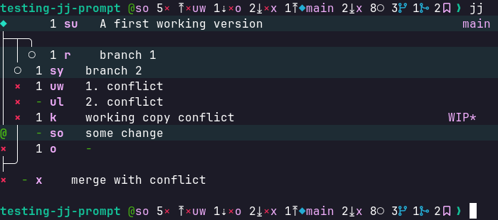

## What it does

Calls `jj log` and creates a prompt from the info.

Shows:
- working copy ID (@) state and stats
- offset and ID of conflicts: first (to @), previous/next to @ and last
- offset and ID w.r.to @-branch of last immutable (main) and last
- number of branches, merges and bookmarks



By default, all prompt sections are shown, with `@` first. Use `-s` or `--show` to select sections; repeat it to choose their output order. Include `@` wherever you want the working copy ID to appear. Unique prefixes are accepted, for example `-s m` selects `main`; ambiguous prefixes are rejected.

```sh
jj-prompt -s conflicts -s branches -s @
```

Available sections are `@`, `stats`, `conflicts`, `branches`, `main`, `last-change`, and `counts`.

## Options

- `-s`, `--show <SECTION>`: select sections and their order, see above.
- `--shell <plain|bash|zsh|fish>`: mark color codes as zero-width for the shell, see [Shell prompt](#shell-prompt). Defaults to `plain`, i.e. raw color codes.
- `-t`, `--test`: print the `jj` command, jj errors and diagnostic information.

## Behavior

- Outside of a jj repo, or when `jj` fails otherwise, nothing is printed and the exit status is 1. jj errors are only shown with `--test`.
- `jj` is run with `--ignore-working-copy`, so the prompt never snapshots the working copy. This keeps the prompt fast and avoids jj doing work you did not ask for. As a consequence the stats of `@` show the state as of the last `jj` command you ran, not edits made since.

## Install

```sh
cargo install --path .
```

### Starship

```toml
format = "[$directory${custom.jj-prompt}]($style)$character"

[custom.jj-prompt]
when = "jj root --ignore-working-copy --quiet"
format = "$output "
shell = "jj-prompt"
ignore_timeout = true
```

Starship handles the color codes itself, so no `--shell` is needed.

### Shell prompt

Or use it directly in your shell prompt. Pass `--shell` so the shell knows the
color codes take no space, otherwise line editing breaks for long commands.
Outside of a jj repo the output is empty, so no extra check is needed.

```sh
# bash: color codes are wrapped in readline's \001 and \002 markers,
# which, unlike \[ \], also work in command substitution
PS1='$(jj-prompt --shell bash) \$ '

# zsh: color codes are wrapped in %{ %} and % is escaped as %%
setopt prompt_subst
PROMPT='$(jj-prompt --shell zsh) %# '
```

```fish
# fish needs no wrapping
function fish_prompt
    jj-prompt --shell fish | string collect
    echo -n ' > '
end
```
